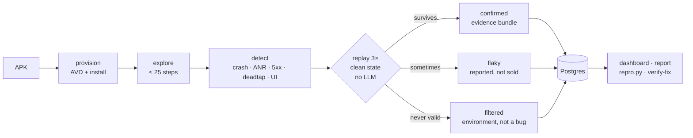

# Litmus

Litmus is a backend platform for Android bug hunting. You upload an APK, an agent
explores it on an emulator, and it flags crashes, network errors and broken UI.
Every finding is then replayed three times from a clean app state. Only what
reproduces reaches the report, and each entry ships with a repro script,
screenshots and logs.

**[Watch the 2 min 36 s walkthrough](https://youtu.be/lnc4VVDDbt4)**

---

## How it works

1. **Upload** — hand an APK to the CLI, the dashboard or an MCP client. Litmus
   reads the package, picks a crawl profile and installs it on a local emulator.
2. **Explore** — a heuristic crawler taps through the app for up to 25 steps,
   resolving elements by resource id, then text, then path, then bounds.
3. **Detect** — crash and ANR buffers, proxy flows, tap outcomes and screen
   layout are checked on every step.
4. **Replay** — for each candidate the app is cleared, relaunched, and the
   recorded trace is replayed with the same selectors, three times.
5. **Report** — findings that reproduce are marked `confirmed`; findings that
   only sometimes reproduce are marked `flaky` and counted separately.



A run moves through one state machine:

```
queued → provisioning → installing → exploring → detecting → verifying
       → reporting → done | failed | cancelled
```

Replay is deterministic and needs no model: `pm clear`, launch, drive the saved
trace by selector, poll for the recorded signature. An attempt that cannot reach
the recorded screen is an environment problem and is never counted as a fix.

## What it detects

| Kind | Confidence | What proves it on replay |
|---|---|---|
| `crash` | hard | the same `logcat -b crash` fingerprint (exception + message token) |
| `anr` | hard | `ANR in <pkg>` in the logcat buffers, 5 s framework grace |
| `http_5xx` | hard | a new proxy flow with the same `method path status` |
| `http_4xx` | heuristic | opt-in per profile, API paths only, 404 by default |
| `deadtap` | heuristic | navigation, node content and whole-screen content unchanged, no IME, no toast, no request |
| `ui_broken` | heuristic | the same overlap, zero-size or clipped signature on screen |
| `pinning`, `unsupported_abi` | filtered | environment, reported apart from bugs |

Hard kinds are objective. Heuristic kinds survive replay, which removes
flakiness — not judgement — so the report always says which is which.

## Quickstart

### 1. No device: install, tests, dashboard

```powershell
python -m venv .venv
.venv\Scripts\pip install -e ".[dev]"
copy .env.example .env                       # fill DATABASE_URL; Redis is optional
.venv\Scripts\python.exe -m pytest -q         # 216 tests, no device, no network
.venv\Scripts\python.exe -m litmus.api        # dashboard on http://127.0.0.1:8000
```

`DATABASE_URL` is the only setting the control plane needs. Without Redis the API
runs one lifecycle in-process (single-process dev fallback) and `mqa doctor`
reports it as a warning rather than a failure.

### 2. With a device: a real run against the APK in this repo

`demo/fixed-bazaar.apk` is the patched demo build, so it is in the repo and you
can drive it without cloning the fixture.

```powershell
.venv\Scripts\pip install -e ".[runner,proxy]"  # uiautomator2, mitmproxy
adb devices                                     # any API 33 x86_64 emulator
.venv\Scripts\mqa.exe doctor                    # python, adb, device, proxy, Postgres, disk
.venv\Scripts\mqa.exe run --apk demo/fixed-bazaar.apk --profile bazaar --steps 10
```

Evidence lands in `artifacts/<run_id>/` (gitignored): `run.json`, and per finding
a `trace.json`, `repro.py`, screenshot, proxy flows and
`verification/F*/attempt_{1,2,3}/` for each replay.

### 3. Benchmark: needs the fixture checkout

The benchmark drives **Bazaar**
([`iamsiddhesh-dev/bazaar`](https://github.com/iamsiddhesh-dev/bazaar)), a small
shopping app with five seeded defects and their ground truth. Clone it next to
this repo, then:

```powershell
git clone https://github.com/iamsiddhesh-dev/bazaar ../bazaar
.venv\Scripts\mqa.exe bench --fixture bazaar --runs 3
```

`bench` starts the fixture's mock API, drives the seeded flow, scores recall and
false positives against `benchmark/expected_findings.json`, and writes
`benchmark/results/<timestamp>.json`. `fixtures/bazaar.yaml` takes the APK from
that checkout or, when it is absent, downloads the published `v1.0.3` release
APK. The mock API still comes from the checkout, so clone it for the network
findings.

## Benchmark

Ground truth is the read-only fixture app and its five seeded defects (B1–B5).
Scoring is mechanical (`benchmark/run_bench.py`): recall counts only **confirmed**
matches to B1–B4, and a *confirmed* B5 is a **false positive** — B5 has a random
trigger, so `flaky` or `N/A` is the honest answer.

Result of `mqa bench --fixture bazaar --runs 3` on 27 Oct 2026:
`benchmark/results/20261027-170453.json`.

| Run | B1 `crash` | B2 `http_5xx` | B3 `deadtap` | B4 `ui_broken` | B5 random | Recall | False positives |
|---|---|---|---|---|---|---|---|
| 1 | confirmed 3/3 | confirmed 3/3 | confirmed 3/3 | confirmed 3/3 | `N/A` | **4/4** | 0 |
| 2 | confirmed 3/3 | confirmed 3/3 | confirmed 3/3 | confirmed 3/3 | `N/A` | **4/4** | 0 |
| 3 | confirmed 3/3 | confirmed 3/3 | confirmed 3/3 | confirmed 3/3 | `N/A` | **4/4** | 0 |
| **Total** | | | | | `N/A, N/A, N/A` | **3/3 runs at 4/4** | **0** |

Every confirmed finding replayed 3/3 on a clean state. B5 never fired in these
crawls; the scorer would have counted a confirmed B5 as a false positive.

An earlier version of this benchmark missed B3 in one run because the emulator's
own connectivity probes were read as network activity inside the tap window.
That was fixed in the detector — not in the ground truth — and pinned by two
regression tests. These three runs are on the fixed code.

The same four kinds were confirmed on a live dashboard run
(`run_20261027-174314-198a67`: 15 steps, 519 s, `confirmed 4 · flaky 0`). The
dashboard footage in the walkthrough is that run, not a mockup.

Reproduce it with `mqa bench --fixture bazaar --runs 3`; raw JSON lands in
`benchmark/results/`. The fixture repo is never modified, so results stay
comparable across commits. `docs/BENCHMARK.md` documents the scoring rules.

## verify-fix

`verify-fix` closes the loop after a developer ships a fix: it loads the saved
trace and probe for a finding, installs a new APK and replays the same steps.

```text
mqa run            →  F2  crash  java.lang.NullPointerException:Integer.intValue   confirmed 3/3
developer fixes it →  demo/fixed-bazaar.apk  (patched copy of the fixture app)
mqa verify-fix     →  fixed
same command, old APK →  still reproduces
```

Real output from the demo build:

```text
$ mqa verify-fix --finding F2 --run bench-20261027-170453-1 --apk demo/fixed-bazaar.apk
    finding  F2  crash  java.lang.NullPointerException:Integer.intValue
    attempt  1/3  valid  not reproduced  no matching crash
    attempt  2/3  valid  not reproduced  no matching crash
    attempt  3/3  valid  not reproduced  no matching crash
fixed
  the signature did not reproduce in 3/3 clean transitions of the saved trace
```

It prints **`fixed`** (exit 0) or **`still reproduces`** (exit 1). Exit 2 means
the trace could not be replayed — an error, never a fix.

Artifacts are gitignored, so create your own run first:

```powershell
.venv\Scripts\mqa.exe verify-fix --finding F2 --run <run_id> --apk demo/fixed-bazaar.apk
```

The demo APK is built from a **copy** of the fixture app
(`demo/build_fixed_apk.ps1`); the benchmark's source of truth stays read-only.

## Evidence bundle

Every finding carries its own directory, so a bug report can be checked without
rerunning anything:

```
artifacts/<run_id>/F2/
  trace.json          recorded steps (selectors, hashes) that triggered it
  repro.py            standalone script: drives adb, prints the verdict
  screen_before.png   the screen the tap started on
  screen_at_bug.png   the screen where the signature appeared
  logcat.txt          crash buffer slice, or the flow JSON for HTTP kinds
  logcat_full.txt     full logcat for offline debugging
  flows.json          proxy flow(s) behind an HTTP finding
  manifest.json       kind, confidence, verdict, hashes, artifact index
artifacts/<run_id>/verification/F2/attempt_{1,2,3}/   proof of each replay
```

`repro.py` uses the same primitives as the runner, so it is a real reproduction
rather than a summary.

## Dashboard, API and MCP

```powershell
.venv\Scripts\python.exe -m litmus.api                # http://127.0.0.1:8000
.venv\Scripts\arq.exe litmus.worker.WorkerSettings    # Arq worker (needs Redis)
```

`POST /v1/runs` queues through Arq when Redis is up; with Redis down the API runs
the lifecycle in-process, so the dashboard never accepts a job nobody consumes.

The dashboard form takes **one input — the APK**. The profile is resolved from
the package (`litmus/profiles.py`, e.g. `com.bazaar.demo → bazaar`) and the crawl
budget defaults to 25 steps, so nobody is asked to pick a value they cannot
evaluate. `POST /v1/runs` still accepts `profile` and `steps` for the CLI,
`mqa bench` and MCP callers.

MCP clients get the same control plane:

```json
{
  "mcpServers": {
    "litmus": {
      "command": "python",
      "args": ["-m", "litmus.mcp_server"]
    }
  }
}
```

```python
run_test(apk_path="demo/fixed-bazaar.apk", profile="bazaar", steps=10)
# -> {"run_id": "run_20261027-170453-9f3c1a", "status": "queued",
#     "report_url": "http://127.0.0.1:8000/runs/run_20261027-170453-9f3c1a",
#     "mode": "api"}
```

`run_test` never blocks: it hands the APK to the control plane (or a daemon
thread when no API is listening) and returns the id. `get_run` and `get_report`
read the API and fall back to the saved `run.json`.

## Integrations

| Integration | Behaviour |
|---|---|
| Slack | webhook on `done`: confirmed and flaky counts plus the report link; no-op when unset, 3 s timeout, never delays the verdict |
| CI | `.github/workflows/litmus.yml`: `unit` (lint + device-free tests) runs on every push to `main`; `run-test` drives a real device over the API (`X-Litmus-Token`) and only runs where a `self-hosted, windows, android-emulator` runner exists and `LITMUS_DEVICE_CI=true` is set, otherwise it is skipped, never queued |
| MCP | `run_test`, `get_run`, `get_report` |

The Slack path was verified end to end: run `bench-20261027-170453-1`
(`4 confirmed in 639s`) posted to a real incoming webhook, and the walkthrough
shows that payload.

## Repo layout

```
litmus/
  api/            FastAPI: REST, SSE stream, dashboard, report
  worker/         lifecycle (explore → detect → replay), policy, verify, verify_fix, evidence
  runner/         adb driver (selector ladder), local AVD, mitmproxy supervisor + addon
  detectors/      crash, anr, network, deadtap, ui, environment
  ingest/         APK inspection (package, version, ABIs)
  db/             SQLAlchemy 2 async models, store, schema.sql
  services/       optional integrations (Slack)
  mcp_server.py   FastMCP tools
profiles/         how to drive a target (target-specific code never goes in litmus/)
fixtures/         target + APK + mock backend
benchmark/        ground truth, scoring, results
demo/             fixed-APK build script, patched APK, java diff
tests/            device-free unit tests for every module
```

## Configuration

`.env`, copied from `.env.example` — every variable there is read by the code:

| Variable | Purpose |
|---|---|
| `DATABASE_URL` | Postgres for the control plane (runs, findings, history) |
| `REDIS_URL` | Arq queue; optional in dev |
| `OPENROUTER_API_KEY`, `TOGETHER_API_KEY` | optional model keys; the crawler is heuristic-first and needs none |
| `LITMUS_AVD`, `ANDROID_HOME`, `ANDROID_SDK_ROOT` | emulator and SDK |
| `ARTIFACTS_DIR` | evidence root, defaults to `<repo>/artifacts` |
| `LOG_LEVEL` | log verbosity |
| `API_HOST`, `API_PORT`, `API_TOKEN` | control plane binding and optional shared secret |
| `SLACK_WEBHOOK_URL` | completion notification |

A CLI run needs an attached emulator and nothing else; `DATABASE_URL` is only
required for the dashboard, REST and history.

## Limitations

True of this build today:

- **One device, one run at a time.** A local AVD over adb; no device farm, no
  parallel runs. The dashboard queues work, it does not scale it.
- **The crawl is heuristic.** It can miss a bug that needs a specific data path,
  and it will not invent one. LLM-assisted steps exist but stay off unless a
  model key is set; all benchmark numbers come from the heuristic crawler.
- **`deadtap` and `ui_broken` are heuristics.** Replay removes flakiness, not
  judgement: on a 720×1280 AVD the `ui_broken` overlap probe replayed 1/3 and was
  reported `flaky`, while the same finding confirmed 3/3 on the benchmark AVD.
  Expect confirmations to depend on the screen you run on. `crash`, `anr` and
  `http_5xx` are hard signals and behave consistently.
- **`http_4xx` is opt-in**, because plenty of apps use 4xx deliberately.
- **TLS-pinned apps are filtered, not bypassed.** No CA is installed on the
  device, so their traffic is not inspected.
- **Evidence is screenshots and logs, not a screen recording.** Per finding you
  get `screen_before.png`, `screen_at_bug.png`, `trace.json`, `logcat_full.txt`,
  proxy flows and `repro.py`, plus the same set under each replay attempt.
- **The benchmark is one fixture app** with five seeded defects. It is a sanity
  check, not a survey.
- **Single tenant, loopback only.** No accounts, no auth beyond an optional
  `API_TOKEN`; do not expose the API.
- **Android only.** No iOS, and no React Native or Flutter handling beyond what
  the accessibility tree exposes.
- **Without Redis the API runs one lifecycle in-process** — fine for one user,
  while the Arq path is what makes it a queue.

## License

MIT — see [LICENSE](LICENSE).
