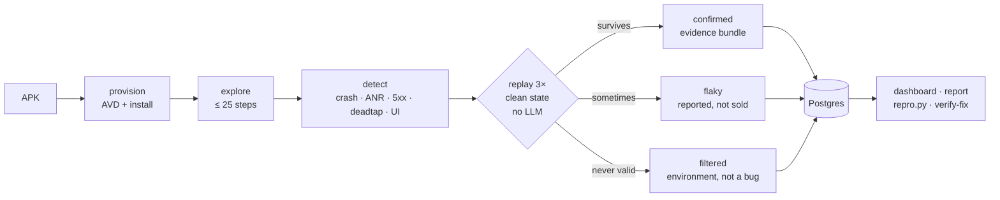

# Litmus

**A litmus test for mobile bugs. Every finding is replayed 3× from a clean app
state before it reaches your report.**

Litmus drives an Android app on a real emulator, watches logcat, the screen and
the network, and turns "something looked wrong" into a **reproducible** bug with
a trace, a screenshot, the proxy flow, and a standalone `repro.py`. Findings that
cannot survive replay are marked **flaky** instead of becoming a ticket.

---

## The problem

One tap is not a bug report.

- A crash that fires one time in three gets dismissed as noise.
- A price overlapping its title ships because nobody re-checked that screen.
- A dead button — no navigation, no toast, no request — is invisible to
  scripted tests that only assert on element presence.
- Manual QA cannot replay what it just saw, so the same bugs come back.

Replay is the missing step: **an observation becomes a bug only if it happens
again on demand.**

## How it works



Run state machine:

```
queued → provisioning → installing → exploring → detecting → verifying
       → reporting → done | failed | cancelled
```

The verifier is deterministic: `pm clear`, launch, replay the recorded trace with
**selectors only** (resource id → text → path → bounds), then poll for the
recorded signature. Three valid attempts are required; an *invalid* attempt
(wrong screen, selector gone) is an environment signal, never a "not a bug".

## What it detects

| Kind | Confidence | How it is proven on replay |
|---|---|---|
| `crash` | **hard** | `logcat -b crash` fingerprint (exception + message token) reappears |
| `anr` | **hard** | `ANR in <pkg>` in the logcat buffers, 5 s framework grace |
| `http_5xx` | **hard** | a new proxy flow with the same `status method path` |
| `http_4xx` | heuristic | opt-in per profile, API paths only, 404 by default |
| `deadtap` | heuristic | nav + node content + whole-screen content unchanged, no IME, no toast, no request |
| `ui_broken` | heuristic | the same overlap / zero-size / clipped signature on screen |
| `pinning`, `unsupported_abi` | filtered | environment, reported apart from bugs |

Hard kinds are objective. Heuristic kinds survive replay, which filters
flakiness — not wrong heuristics; the report says which is which.

## Benchmark

Ground truth: the read-only **Bazaar** fixture app with five seeded defects
(B1–B5). Scoring is mechanical (`benchmark/run_bench.py`): recall counts only
**confirmed** matches to B1–B4, and a *confirmed* B5 would be a **false
positive** — B5 is a random trigger, so `flaky` or `N/A` is the honest answer.

<!-- BENCHMARK:TABLE -->

### Result — 27 Oct 2026, three runs on the shipped code

`mqa bench --fixture bazaar --runs 3` → `benchmark/results/20261027-170453.json`

| Run | B1 `crash` | B2 `http_5xx` | B3 `deadtap` | B4 `ui_broken` | B5 random | Recall | False positives |
|---|---|---|---|---|---|---|---|
| 1 | confirmed 3/3 | confirmed 3/3 | confirmed 3/3 | confirmed 3/3 | `N/A` | **4/4** | 0 |
| 2 | confirmed 3/3 | confirmed 3/3 | confirmed 3/3 | confirmed 3/3 | `N/A` | **4/4** | 0 |
| 3 | confirmed 3/3 | confirmed 3/3 | confirmed 3/3 | confirmed 3/3 | `N/A` | **4/4** | 0 |
| **Total** | | | | | `N/A, N/A, N/A` | **3/3 runs at 4/4** | **0** |

Every confirmed finding replayed **3/3 on a clean state**. B5 is a random trigger
that never fired in these crawls: `N/A` is the honest answer, and a *confirmed*
B5 would be counted as a false positive by the scorer.

The first attempt at this benchmark missed B3 in one run — the emulator's own
connectivity probes were counted as "network activity" in the tap window. That
was fixed in the detector (not in the ground truth) and pinned by two regression
tests; these three runs are on the fixed code.


Reproduce with `mqa bench --fixture bazaar --runs 3`; the raw JSON lands in
`benchmark/results/`. The fixture repo is never modified, so these numbers are
comparable across commits.

## Quickstart

```powershell
# 1. environment
python -m venv .venv
.venv\Scripts\pip install -e ".[dev,runner,proxy]"
.venv\Scripts\mqa.exe doctor          # python, adb, AVD, Postgres, Redis, disk

# 2. emulator + the fixture's mock backend
& "$env:ANDROID_HOME\emulator\emulator.exe" -avd pricebook_avd -no-snapshot
.venv\Scripts\python.exe E:\bazaar\mock-api\main.py

# 3. one run: explore, detect, replay, evidence
.venv\Scripts\mqa.exe run --apk <path>\app-debug.apk --profile bazaar --steps 25

# 4. score the platform against the fixture
.venv\Scripts\mqa.exe bench --fixture bazaar --runs 3

# 5. prove a fix on a new build
.venv\Scripts\mqa.exe verify-fix --finding F2 --run <run_id> --apk demo/fixed-bazaar.apk
```

Control plane (dashboard, REST, SSE):

```powershell
.venv\Scripts\python.exe -m litmus.api                # http://127.0.0.1:8000
.venv\Scripts\arq.exe litmus.worker.WorkerSettings    # Arq worker (needs Redis)
```

`POST /v1/runs` queues on Arq when Redis is up; with Redis down the API runs one
lifecycle in-process (documented single-process dev fallback), so the dashboard
never accepts a job nobody will consume.

## verify-fix — the demo loop

```text
mqa run            →  F2  crash  java.lang.NullPointerException:Integer.intValue   confirmed 3/3
developer fixes it →  demo/fixed-bazaar/  (patched copy of the fixture app)
mqa verify-fix     →  fixed
same command, old APK →  still reproduces
```

Real output from the demo build (`demo/fixed-bazaar.apk`, 28 KB, patched copy):

```text
$ mqa verify-fix --finding F2 --run bench-20261027-170453-1 --apk demo/fixed-bazaar.apk
    finding  F2  crash  java.lang.NullPointerException:Integer.intValue
    attempt  1/3  valid  not reproduced  no matching crash
    attempt  2/3  valid  not reproduced  no matching crash
    attempt  3/3  valid  not reproduced  no matching crash
fixed
  the signature did not reproduce in 3/3 clean transitions of the saved trace
```

`verify-fix` loads the saved trace and the probe from `artifacts/<run>/run.json`,
installs the new APK, and replays selectors-only. It prints **`fixed`** (exit 0)
or **`still reproduces`** (exit 1). An invalid replay exits 2 — an unreplayable
trace is an error, never a fix.

The demo APK is built from a **copy** (`demo/build_fixed_apk.ps1`): the fixture
repo stays read-only, so the benchmark it backs stays honest.

## Evidence bundle

Every confirmed finding carries its own directory:

```
artifacts/<run_id>/F2/
  trace.json          the recorded steps (selectors, hashes) that triggered it
  repro.py            standalone script: installs nothing, drives adb, prints the verdict
  screen_before.png   the screen the tap started on
  screen_at_bug.png   the screen where the signature appeared
  logcat.txt          the crash buffer slice (or the flow JSON for HTTP kinds)
  logcat_full.txt     full logcat for offline debugging
  flows.json          the proxy flow(s) that prove an HTTP finding
  manifest.json       kind, confidence, verdict, hashes, artifact index
artifacts/<run_id>/verification/F2/attempt_{1,2,3}/   proof of each replay
```

`repro.py` uses the same primitives as the runner — it is a real reproduction,
not a summary.

## MCP

```json
{
  "mcpServers": {
    "litmus": {
      "command": "E:\\litmus\\.venv\\Scripts\\python.exe",
      "args": ["-m", "litmus.mcp_server"]
    }
  }
}
```

```python
run_test(apk_path="E:\\builds\\app-debug.apk", profile="bazaar", steps=25)
# -> {"run_id": "run_20261027-170453-9f3c1a", "status": "queued",
#     "report_url": "http://127.0.0.1:8000/runs/run_20261027-170453-9f3c1a",
#     "mode": "api"}
```

`run_test` never blocks on the run: it hands the APK to the control plane (or a
daemon thread when no API is listening) and returns the id. `get_run` and
`get_report` read the API, falling back to the saved `run.json`.

## Integrations

| Integration | Behaviour |
|---|---|
| Slack | webhook on `done`: confirmed/flaky counts + report link; **no-op** when unset, 3 s timeout, never delays the verdict |
| CI | `.github/workflows/litmus.yml` triggers over the API (`X-Litmus-Token`); GitHub-hosted runners have no emulator, so it targets a self-hosted runner |
| MCP | `run_test`, `get_run`, `get_report` |

The Slack path is verified end to end: run `bench-20261027-170453-1`
(`4 confirmed in 639s`) was posted to a real incoming webhook — `notify_done(...)
-> True` — and the message body is what `demo/video/src/slack.ts` renders.

## Architecture / repo layout

```
litmus/
  api/            FastAPI: REST, SSE stream, dashboard, report (no run state of its own)
  worker/         lifecycle (explore → detect → replay), policy, verify, verify_fix, evidence
  runner/         adb driver (selector ladder), local AVD, mitmproxy supervisor + addon
  detectors/      crash, anr, network, deadtap, ui, environment
  ingest/         APK inspection (package, version, ABIs)
  db/             SQLAlchemy 2 async models, store, schema.sql
  services/       optional integrations (Slack)
  mcp_server.py   FastMCP tools
profiles/         how to drive a target (never target-specific code in litmus/)
fixtures/         target + APK + mock backend
benchmark/        ground truth, scoring, results
demo/             fixed-APK build script + Remotion video project
tests/            device-free unit tests for every module
```

Configuration (`.env`, see `.env.example`): `DATABASE_URL`, `REDIS_URL`,
`OPENROUTER_API_KEY`/`TOGETHER_API_KEY` (optional — the platform is
heuristic-first), `LITMUS_AVD`, `ANDROID_HOME`, `LITMUS_ARTIFACTS_DIR`,
`RUNNER_KIND`, `API_HOST`, `API_PORT`, `API_TOKEN`, `SLACK_WEBHOOK_URL`,
`LOG_LEVEL`. Nothing is required except an attached emulator for a real run.

## Limitations

- One device at a time (a local AVD); no device farm support.
- The crawl is heuristic: it can miss a bug that needs a specific data path.
- `deadtap` and `ui_broken` are heuristics — replay removes flakiness, not
  judgement. The report labels confidence for exactly this reason.
- `http_4xx` is opt-in: many apps use 4xx deliberately.
- TLS-pinned apps are filtered, not bypassed (no CA install on the device).
- The benchmark is one fixture app; it is a sanity check, not a survey.

## How Alan was used

This repository was built **milestone by milestone with an AI agent (Alan
Code)**, and the workflow is part of the deliverable:

- **Branch per milestone** (`build/m1-…` … `build/m4-…`), never on `main`.
- **Acceptance gates**: each milestone ends with real commands (`mqa doctor`,
  `mqa run`, `mqa verify-fix`, `mqa bench`, `pytest -q`, `ruff check .`) whose
  output is pasted into the session log before the commit — and the agent
  **stops** for the human to push.
- **Human-owned decisions**: architecture, ground truth, what counts as a false
  positive, and every push. The agent wrote code, tests and documentation, and
  ran the device.
- **Agent-owned findings**: e.g. the dead-tap detector's false-negative on
  connectivity-probe traffic was found by reading `verification/` attempts,
  fixed in the probe (not in the ground truth), and pinned with a regression
  test.

No acceptance criterion was weakened to make a milestone pass; a missed bug is
reported, and a `filtered` verdict is treated as an environment problem.

## LICENSE

MIT — see [LICENSE](LICENSE).
